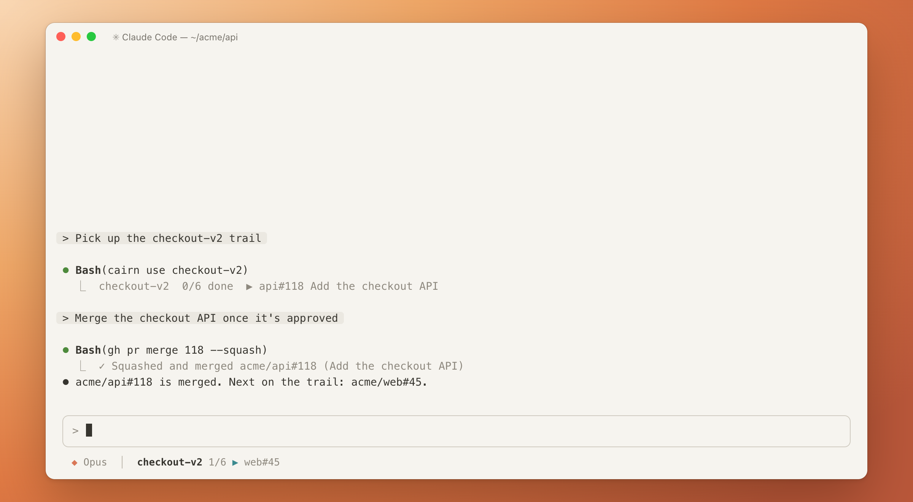

<p align="center">
  
</p>

<h1 align="center">cairn</h1>

<p align="center">
  <b>Stack your PRs. Follow the trail.</b><br>
  A checklist of the PRs and steps each agent session works through, kept up to date as the agent works.
</p>

Hikers stack stones into cairns so the next person can find the way. Your work leaves a
trail too: an API change in one repo, its client in another, then a release and a
feature flag that aren't PRs at all. cairn keeps that chain as a **trail**, an ordered
checklist, and fills it in as your agent opens and pushes PRs.

Each agent session (a Claude Code or Codex session, or you in a plain terminal pane) works
on its own trail. Sessions share one only when asked to (`cairn use <name>`), so a
teammate, or tomorrow's session, can pick up exactly where you left off.

<p align="center">
  
</p>

## Install

```sh
go install github.com/ken8203/cairn/cmd/cairn@latest
cairn setup
```

This needs Go 1.27, and puts `cairn` in `$(go env GOPATH)/bin`, which must be on `PATH`.
From a checkout, `make install` builds `~/.local/bin/cairn` instead
(`make install PREFIX=/usr/local` for `/usr/local/bin`). Or just ask your agent to "set
up cairn": `cairn skills get setup` tells it how.

`cairn setup` also installs a native Herdr.app panel when `herdr-app` is on `PATH`.
It installs cairn's plugin into Claude Code and Codex, and into herdr when
it's on `PATH`, then runs `cairn doctor` to check the install. Codex runs a plugin's hooks
only once you trust them: open Codex, run `/hooks`, and trust cairn's two.
`cairn setup --dry-run` shows what it would run.

## Trails

A trail is a plain Markdown file in `~/.cairn/trails/`, nothing more:

```markdown
# checkout-v2

- [ ] acme/api#120
- [ ] acme/web#45
- [ ] release api 1.4
- [ ] staging: enable CHECKOUT_V2

## Notes

- 2026-11-02 #120 waiting on review
```

A PR step counts as done once GitHub says merged or closed; any other step is ticked by
hand. Edit the file however you like; cairn only rewrites the lines it changes.

## Use

Most of the time cairn stays out of your way. When an agent opens or pushes a PR, cairn's
hook records it, and a session without a trail gets one, named after the terminal tab you
named, else the PR's branch. A later session in the same repo and branch is told about
that trail, and joins it with `cairn use <name>`. When you do want a hand on the wheel:

```
cairn                  this session's trail, else this folder's, and the PRs it touched
cairn ls               every trail with its progress and next step
cairn use <name>       attach this session to a trail, creating it if needed
cairn add <step>...    append steps: owner/repo#n, a PR URL, or free text
cairn link <n> <pr>    turn free-text step n into that PR once it's open
cairn done <n>         tick (or untick) free-text step n
cairn note <text>      append a note
cairn panel            open or close the trail beside this pane
```

`cairn --help` lists every command.

## Panel

Keep the trail in sight while you work: `cairn panel` opens the pane's trail beside it,
in whatever way your terminal does best. Agents run it when you ask to see the trail;
bind it to a key to toggle it yourself.

**Works in** Rex · tmux · herdr · Herdr.app · Orca, and in any other terminal through
`cairn watch` in a split.

<details>
<summary><b>Rex</b>: a floating layer over the window</summary>

Add an action to `init.lua`:

```lua
rex.action{ name = "cairn", title = "Toggle cairn", run = function(ctx)
  local res = rex.exec{ os.getenv("HOME") .. "/.local/bin/cairn", "panel", "--lua", ctx.block_id }
  if not res.ok then error(res.stderr, 0) end
  loadstring(res.stdout)()
end }
rex.bind("ctrl+cmd+p", "cairn")
```

</details>

<details>
<summary><b>tmux</b>: a popup over the pane</summary>

Bind a key in `~/.tmux.conf`; <kbd>q</kbd> closes the popup:

```tmux
bind-key T run-shell 'cairn panel'
```

</details>

<details>
<summary><b>herdr</b>: an overlay over the pane, from cairn's herdr plugin</summary>

Once `cairn setup` has linked the plugin, bind its `cairn.panel` action in
`~/.config/herdr/config.toml`:

```toml
[[keys.command]]
key = "prefix+t"
type = "plugin_action"
command = "cairn.panel"
description = "toggle cairn"
```

</details>

<details>
<summary><b>Herdr.app</b>: a compact native panel, floating or docked</summary>

`cairn setup` installs the native mod in `~/.config/herdr-app/mods/cairn/`
(`HERDR_APP_HOME`, else `XDG_CONFIG_HOME`, overrides the home). It shows trail
progress, steps, PR state, CI, notes and touched PRs; click a PR to open GitHub.
Clicking the panel keeps the last terminal selected. Editing stays in the CLI.

Run `cairn panel` in a Herdr.app terminal to toggle the last-selected mode; `--close`
closes Cairn in both modes without reopening it. **Dock** places it beside the terminal
and **Float** brings it back to a window. The first Dock creates a personal copy of the
current layout, preserving the original and other panels. Drag the divider to resize;
Herdr remembers the width and Cairn remembers the mode across restarts.

Floating is the default. Escape or `q` closes the panel and `r` refreshes while it has
keyboard focus; docking does not take focus from the terminal. Setup preserves edited
mod files and leaves layouts and keys alone. To bind a key, merge into `keys.json`:

```json
{ "global": { "ctrl-shift-t": "mod.open:cairn" } }
```

Without an installed mod or a reachable app, `cairn panel` uses the `hc` terminal
panel. [Details and remote requirements](docs/reference.md#herdrapp-panel).

</details>

<details>
<summary><b>Orca</b>: a terminal split off the pane, plus worktree cards in sync</summary>

Add an Orca command that runs `cairn panel`. cairn also keeps each worktree's card in sync
with its trail: its PR, the trail's other PRs as references, and a progress note.

</details>

<details>
<summary><b>Ghostty and the rest</b>: any terminal without a pane API</summary>

Run `cairn watch` in a split yourself.

</details>

Inside the TUI panel (the native Herdr.app floating panel uses clickable PR links):

| Key | Action |
| --- | --- |
| <kbd>1</kbd>–<kbd>9</kbd> | open that row's PR in the browser gh uses, or tick that step |
| <kbd>e</kbd> | edit the trail in `$EDITOR` |
| <kbd>r</kbd> | refresh from GitHub now |
| <kbd>j</kbd>/<kbd>k</kbd>, arrows, mouse wheel | scroll a trail taller than the panel |
| <kbd>q</kbd> | close |

## Claude Code statusline

Want the trail one glance away? `cairn statusline` prints the session's trail, its
progress and next step. Append it to
whatever `statusLine.command` `~/.claude/settings.json` already has:

```json
"statusLine": { "type": "command", "command": "<existing command>; ~/.local/bin/cairn statusline" }
```

## Docs

- [Reference](docs/reference.md): how cairn behaves in full — setup and doctor,
  sessions and panes, `~/.cairn`, finding a trail by folder, what the hook records, the
  panel on each host, Orca sync, and the `cairn show --json` format.
- [Architecture](docs/architecture.md): how the code is laid out, for working on cairn.
  Build with `make build`, test with `make test`.
